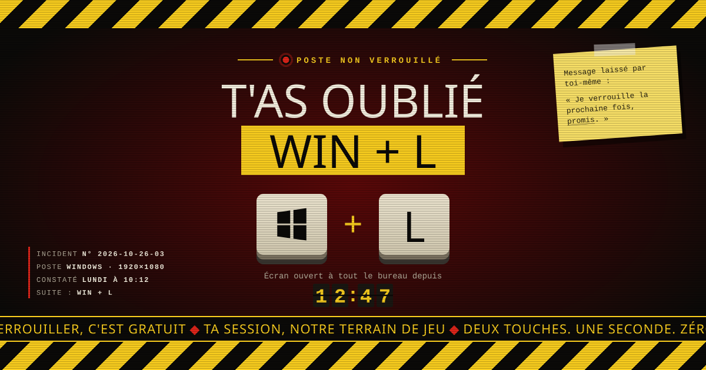

# WIN + L



**Une page web à afficher sur le poste d'un collègue qui a oublié de verrouiller sa session.**

Tu passes devant un écran resté ouvert ? Ouvre la page en plein écran et laisse-la faire le travail. À son retour, ton collègue trouve une alerte de chantier, un chronomètre qui compte depuis combien de temps son poste est ouvert à tout le bureau, et un rappel difficile à ignorer : `Win + L`.

Le but est la sensibilisation à la sécurité, sur le ton de l'humour : rien n'est modifié sur le poste, tout se passe dans un onglet du navigateur.

## Ce que fait la page

| Élément | Comportement |
| --- | --- |
| **Titre** | Choisi au hasard parmi une vingtaine de variantes à chaque ouverture (« T'as oublié Win + L », « Deux touches. Win + L. C'était trop ? »…). |
| **Raccourci selon le système** | Sur macOS la page affiche `Command + Control + Q` avec les logos ⌘ et ⌃ ; partout ailleurs, `Win + L`. Les touches s'enfoncent l'une après l'autre, restent maintenues ensemble, puis se relâchent au même instant. |
| **Chronomètre** | Façon afficheur d'aéroport, il compte le temps écoulé depuis l'ouverture de la page. |
| **Paliers** | Le message sous le chrono s'aggrave avec le temps : 30 s, 1 min, 5 min, 10 min… jusqu'à 3 h. |
| **Fond qui rougit** | Le fond vire progressivement au rouge sombre en 10 minutes ; les rayures passent du jaune à l'orange puis au rouge. |
| **Bandeau défilant** | Une trentaine de piques défilent en bas de l'écran à vitesse constante. |
| **Rapport d'incident** | Numéro d'incident daté, plateforme et résolution de l'écran, heure du constat. Le numéro s'incrémente à chaque nouvelle ouverture dans la semaine (stocké en `localStorage`). |
| **Post-it** | Après 2 minutes, un mot « signé par toi-même » descend dans le coin de l'écran. |
| **Retour de la victime** | Après 20 s d'immobilité, un vrai mouvement de souris ou une touche déclenche un flash « Ah, te voilà. ». |
| **Effets** | Allumage façon tube cathodique, scanlines, grain, glitch du titre toutes les 10 s, onglet et favicon qui clignotent. |

### Raccourcis

- **S** : active ou coupe la sirène deux tons (accélère aussi les animations).
- **Échap** : coupe la sirène.
- **Clic ou n'importe quelle touche** : passe en plein écran.

La page masque le curseur après 2,5 s, bloque le clic droit et les raccourcis des outils de développement, et demande confirmation avant la fermeture de l'onglet.

## Démarrer

### Sans rien installer

Ouvre `index.html` dans un navigateur. Le fichier est autonome : polices (Anton, IBM Plex Mono), styles et script sont intégrés, aucune ressource externe n'est chargée.

### Avec Docker

```sh
docker compose up -d
```

La page est servie par `nginx:stable-alpine` sur <http://localhost:8080>. Le conteneur s'appelle `win-l` et redémarre automatiquement.

```sh
docker compose down   # pour l'arrêter
```

## Structure du dépôt

```
.
├── index.html           # la page complète (HTML, CSS, JS et polices en base64)
├── docker-compose.yml   # service nginx qui monte index.html en lecture seule
└── docs/
    └── illustration.svg # l'illustration de ce README
```

## Personnaliser

Tout se règle dans `index.html` :

- **Titres** : tableau `titresH1`, chaque entrée est `[avant, texte surligné, après]`.
- **Piques du bandeau** : tableau `piques`.
- **Paliers de temps** : tableau `paliers`, sous la forme `[secondes, message]`.
- **Raccourcis** : objet `RACCOURCIS`, une entrée `windows` et une entrée `macos`. Chacune porte son nom, son titre d'onglet, et `touches` : la liste des touches dans l'ordre où elles s'enfoncent (du SVG ou une lettre).
- **Couleurs** : variables CSS dans `:root` (`--jaune`, `--rouge`, `--noir`…).

N'écris pas le raccourci en dur dans les textes : utilise les jetons, résolus au chargement selon le système.

| Jeton | Windows | macOS |
| --- | --- | --- |
| `{RACCOURCI}` | Win + L | Command + Control + Q |
| `{NB_TOUCHES}` | Deux touches | Trois touches |
| `{DEPUIS}` | 2001 | Mac OS X |
| `{INDICE}` | position des touches sur un clavier PC | position des touches sur un clavier Mac |

La détection lit `navigator.userAgentData.platform`, sinon `navigator.platform`, sinon l'User-Agent. Tout système qui ne se déclare pas Mac reçoit le raccourci Windows.

## Accessibilité

Tout le décor est marqué `aria-hidden="true"` — bandeaux rayés, voyant, touches, rapport d'incident, post-it, halo et scanlines : un lecteur d'écran ne restitue que le titre et le message, pas l'habillage. Sous 900 px de large, le rapport d'incident et le post-it sont masqués pour garder l'essentiel lisible.

---

*Et pour ne jamais voir cette page : `Win + L` sous Windows, `Command + Control + Q` sous macOS.*
